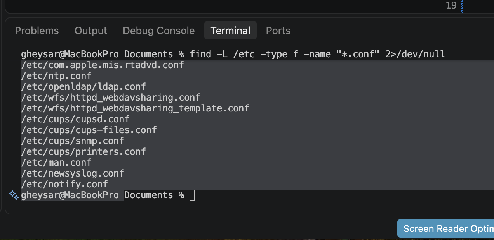

ن# چالش ۲: پیدا کردن فایل‌های conf

## صورت سؤال
با استفاده از دستور `find` فایل‌هایی که پسوند `.conf` دارند را در پوشه `/etc` و زیرپوشه‌های آن پیدا کنید.

## دستور

```bash
find -L /etc -type f -name "*.conf" 2>/dev/null
```

## توضیح
با دستور `find` می‌توانیم فایل‌ها را در پوشه‌های مختلف جست‌وجو کنیم.

- `-L` برای دنبال کردن لینک‌ها
- `-type f` برای پیدا کردن فایل‌ها
- `-name` برای مشخص کردن نام یا پسوند فایل
- `2>/dev/null` برای نمایش ندادن خطاها

چون این تمرین را روی مک انجام دادم، از `-L` استفاده کردم تا فایل‌های داخل مسیر `/etc` هم پیدا شوند.
## خروجی دستور

