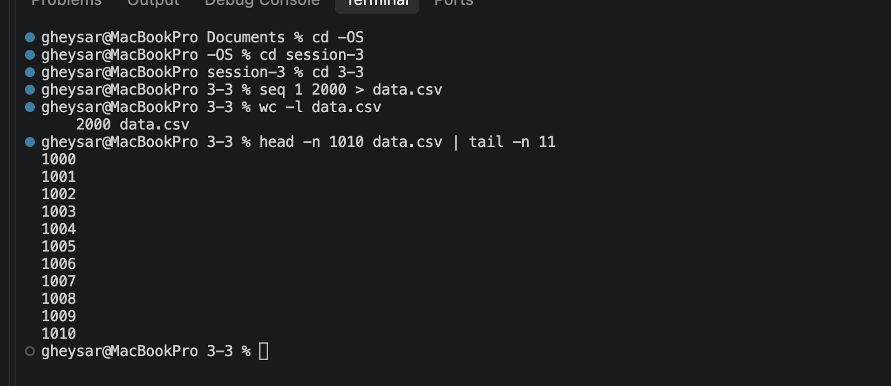

# چالش ۳: برش دقیق فایل

## صورت سؤال
با ترکیب دستورات head و tail و پایپ، خطوط ۱۰۰۰ تا ۱۰۱۰ فایل data.csv را نمایش دهید.

## ساخت فایل آزمایشی

```bash
seq 1 2000 > data.csv
```

## دستور

```bash
head -n 1010 data.csv | tail -n 11
```

## توضیح

- head: انتخاب ۱۰۱۰ خط اول فایل
- tail: نمایش ۱۱ خط آخر
- | : انتقال خروجی دستور اول به دستور دوم

با ترکیب این دو دستور، فقط خطوط ۱۰۰۰ تا ۱۰۱۰ نمایش داده می‌شوند.

## خروجی دستور


